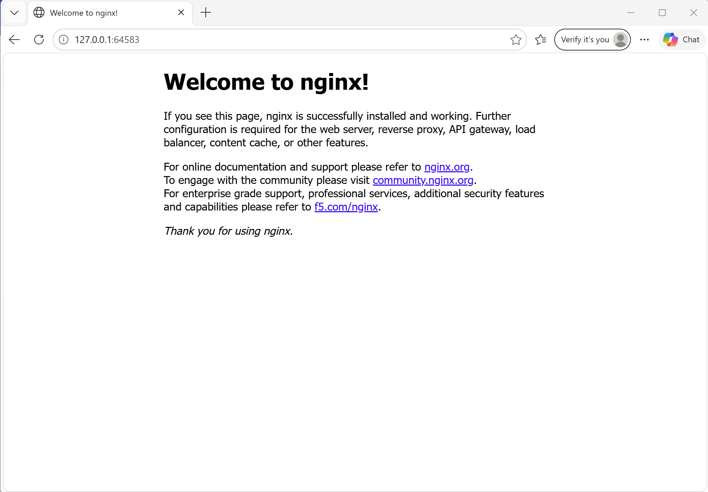

# Exercise 1: Hello Pod

minikube start --driver=docker
kubectl run hello-k8s --image=nginx --port=80
kubectl get pods
kubectl expose pod hello-k8s --type=NodePort --port=80
minikube service hello-k8s

