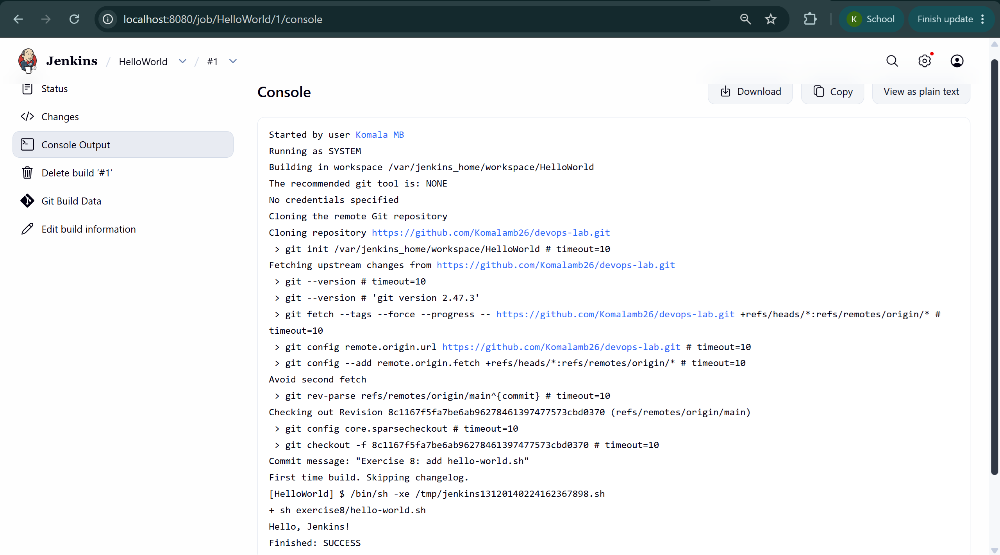

# Exercise 8: Jenkins Hello World Job

hello-world.sh:
#!/bin/bash
echo "Hello, Jenkins!"

Jenkins job: HelloWorld (Freestyle project)
- Source Code Management: Git, this repo, branch */main
- Build step: Execute shell -> sh exercise8/hello-world.sh

Result: console output shows "Hello, Jenkins!" and Finished: SUCCESS.

