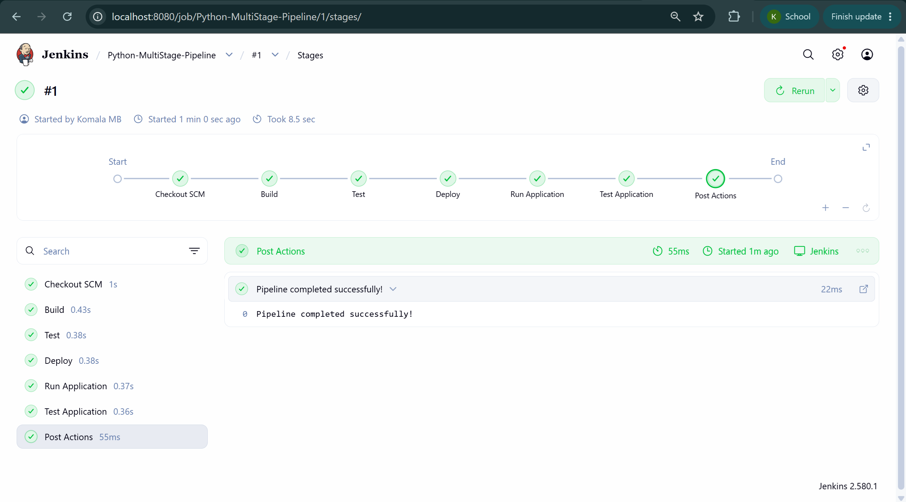
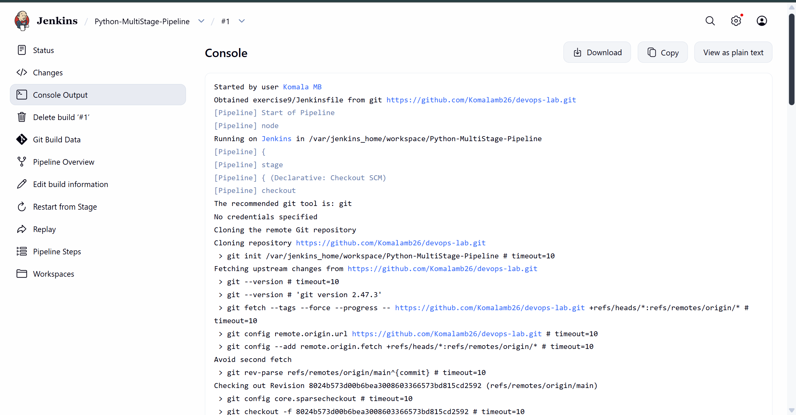
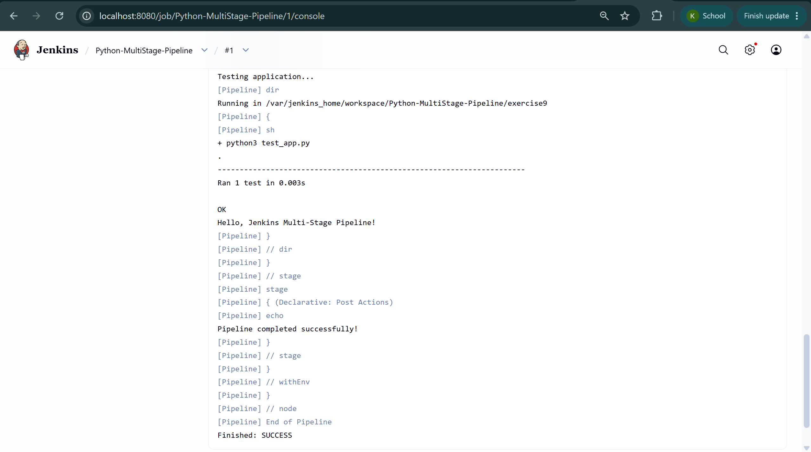

# Exercise 9: Jenkins Multi-Stage Pipeline

Flask app (app.py), unit test (test_app.py), requirements.txt and a Jenkinsfile
with the stages: Build, Test, Deploy, Run Application, Test Application.

Jenkins job: Python-MultiStage-Pipeline (Pipeline script from SCM)
- Repo: this repo, branch */main
- Script Path: exercise9/Jenkinsfile

Python3 and Flask were installed inside the Jenkins container with apt.

Result: all stages passed, Finished: SUCCESS.

